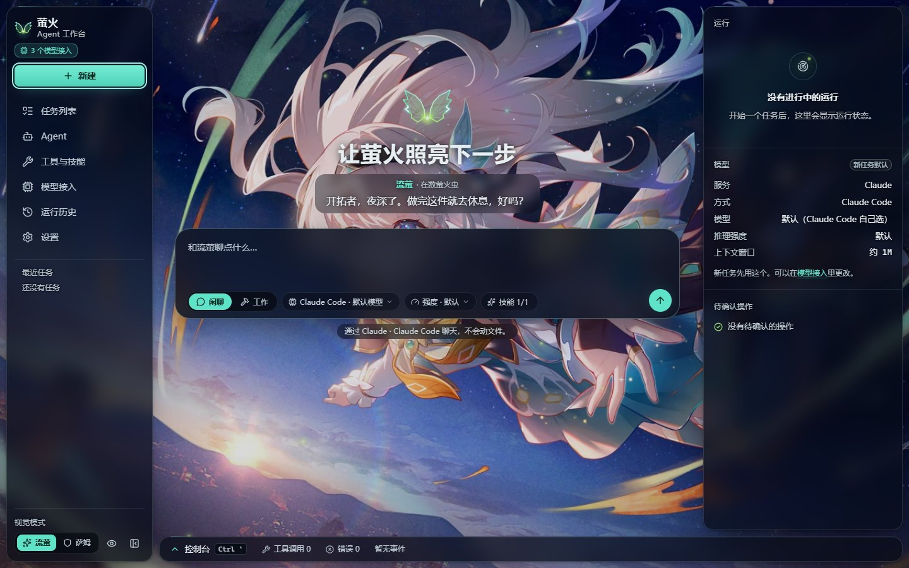
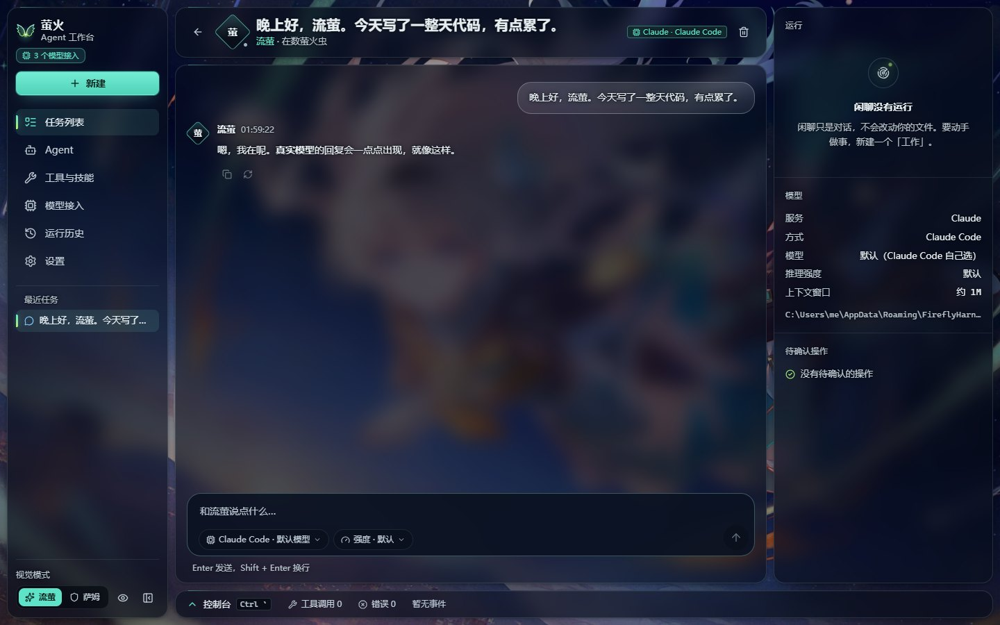
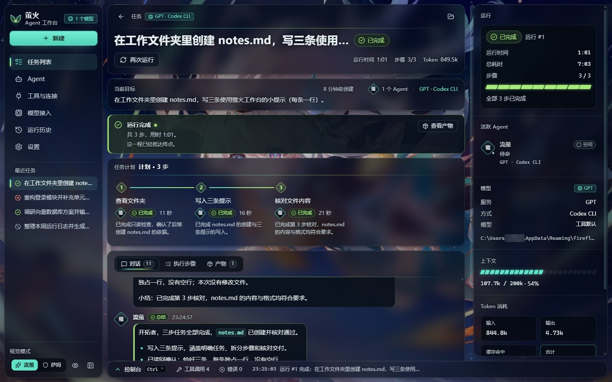
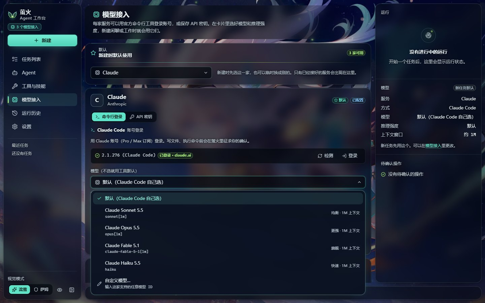
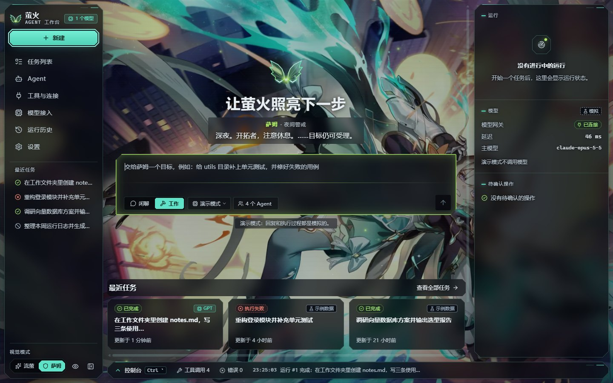
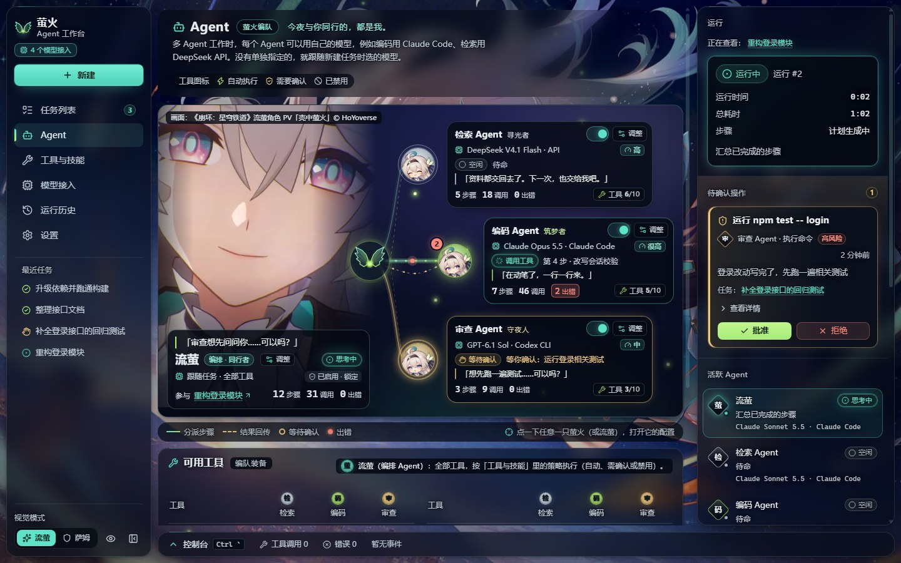
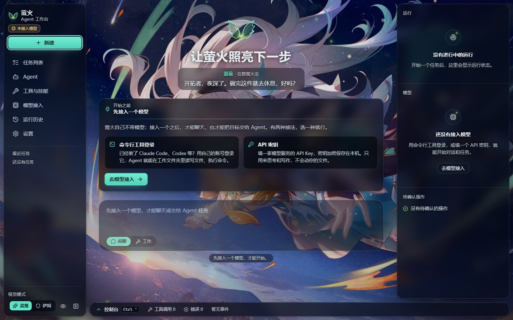
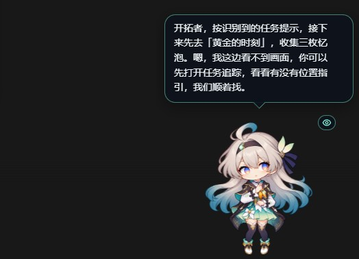

# 萤火 · Agent 工作台（Firefly Harness）

以《崩坏：星穹铁道》角色「流萤 / 萨姆」为灵感的 AI Agent 桌面工作台：和流萤闲聊，或者把一个目标交给她——她会制定计划、调用工具、在关键操作前征求你的确认。可以接入 Claude、GPT、DeepSeek、Kimi、Qwen、GLM、MiniMax、豆包，用命令行工具登录或 API 密钥都行。

> [!IMPORTANT]
> **非官方粉丝同人项目**，与米哈游 / HoYoverse 无任何关联。使用前请阅读 [免责声明与使用条款](DISCLAIMER.md)。
>
> 使用前要先接入一个模型：用 Claude Code、Codex 等命令行工具登录，或填一个 API 密钥（见下方「接入模型」）。界面里的回复、计划、工具调用、终端输出和 Token 统计，都来自你接入的模型和命令行工具的真实运行。



## 下载

到 [Releases](https://github.com/xtdf0224-boop/firefly-harness/releases) 下载（Windows 10 / 11，64 位）：

| 文件 | 说明 |
| --- | --- |
| `FireflyHarness-Setup-x.y.z.exe` | 安装版：流萤与萨姆主题的中文安装向导，可选安装目录，创建桌面与开始菜单快捷方式 |
| `FireflyHarness-x.y.z-portable.exe` | 便携版：免安装，双击即用 |

安装包没有代码签名，Windows SmartScreen 可能提示「已保护你的电脑」，点「更多信息 → 仍要运行」即可。数据只保存在本机。

## 截图

| 闲聊 | 工作（计划 → 执行 → 总结） |
| --- | --- |
|  |  |
| **模型接入** | **萨姆模式** |
|  |  |
| **Agent：萤火编队，每个 Agent 用自己的模型** | **第一次打开：先接入模型** |
|  |  |
| **开机动画标题画面** | **赏图（Alt + W）** |
|  |  |

## 功能

- **新建：闲聊 / 工作**。首页就是一个输入框（参考 Claude、ChatGPT、DeepSeek、Kimi、Cyrene 的布局）：输入框下沿的小标签切换闲聊或工作、选模型；工作时还能选工作文件夹、权限和参与的 Agent。回车发送，Shift + 回车换行。还没有接入模型时，首页会先带你去「模型接入」，接好之前输入框不可用。
- **闲聊**：居中的单列对话，她的回复不套气泡、按 Markdown 渲染；模型给出思考过程时折叠显示（「流萤想了想 · n 字」）；可以复制、重新生成、中途停止，也能在对话中途换模型。
- **工作**：编排 Agent 先用自己的口吻说一两句、给出计划，再一步步执行，最后总结并生成产物（结果汇总、文件改动）。对话里按时间穿插每一次工具调用；写文件、执行命令前出现在「待确认操作」里等你批准或拒绝；可以暂停、继续、取消、从失败处重试或从头运行，运行中发的补充说明会交给 Agent。
- **具体模型与推理强度**：输入框下沿的「模型」菜单按服务分组列出带版本号的具体型号（如 Claude Sonnet 5.5、GPT-6.1 Sol、DeepSeek V4.1 Flash、Kimi K3），每个型号旁标着定位和上下文长度，选项多时可以输入关键字筛选；Codex 会读取你账号实际可用的模型。「强度」只列出所选模型支持的档位（关闭思考 / 低 / 中 / 高 / 很高 / 最高 / 极限）。菜单是应用自己画的，全程可以用键盘操作。
- **每个 Agent 用自己的模型**：「Agent」页是一张「萤火编队」图：编排 Agent 站在左边，检索 / 编码 / 审查 Agent 是右边的三只萤火，卡片上写着所用模型、推理强度、正在做的步骤，以及调用和出错次数。点开任何一只，可以单独选一个已接入的模型（任何服务、任何方式）、推理强度和能用的工具；没单独选的，就跟任务选的模型走，编排 Agent 始终跟任务走。运行时它们的步骤真的由各自的模型执行，计划里会标出这一步用了哪个模型。
- **自定义技能**：导入自己写的技能（带 `SKILL.md` 的文件夹，和 Claude Code / DeepSeek Harness 的格式相同），Agent 会在合适的时候照着做，也可以运行技能里的脚本。见下方「自定义技能」。
- **浏览器控制**：工作任务打开「浏览器」后，命令行 Agent 可以操作独立的「萤火浏览器」窗口——打开网页、读取、点击、输入、截图，你能看到它在做什么，打开网址、点击和输入默认先征求确认。这个窗口有地址栏（后退 / 前进 / 刷新 / 主页）和起始页，你也可以自己打开网页、登录网站，Agent 操作时窗口上会亮起提示。
- **系统托盘**：点窗口的关闭按钮，萤火会缩小到系统托盘，运行中的任务继续进行（设置里可以改成关闭即退出）。托盘菜单可以打开窗口、新建任务、打开萤火浏览器或退出；窗口不在前台时，有操作等你确认、任务完成或失败，会弹出系统通知，点一下就回到对应的地方。
- **桌宠**：在设置里打开后，Q 版流萤（萨姆模式下是萨姆）会待在屏幕角落：认得你在用的程序和游戏，在本机看游戏画面，偶尔搭话；按 Ctrl + Alt + F 打开聊天框问她，需要时她会看一眼画面、联网查攻略，回答可以用她的声音读出来；「实时陪玩」可以直接开口和她聊。见下方「桌宠」。
- **看得见她在做什么**：闲聊里她要查看文件、运行命令时，回复下方会显示「正在查看：…」这样的进度，整段写完才出现复制和重新生成。
- **右侧状态面板**：运行状态与计时、活跃 Agent、所用模型、上下文用量（窗口大小随模型）、Token 消耗。
- **底部控制台**（Ctrl + `）：工具调用（输入 / 输出 / 耗时 / 错误）、终端输出、错误、事件时间线。
- **两种视觉模式**：流萤（柔和安静）与萨姆（装甲强化），切换时说话的口吻也随之切换。
- **主题光标**：流萤是带一只发光小萤火虫的银白箭头（可点击处变成薄荷色），萨姆是切角装甲箭头配萤火绿能量核心；文字、禁止、拖动光标也各有一套，高分屏下同样清晰。可以在设置里关掉。
- **壁纸背景与透明度设计**、**仿崩铁版本开屏的开机动画**、**减少动态效果**支持。

## 接入模型

「模型接入」页里，每一家都可以用两种方式接入：

| 服务 | 命令行登录 | API 密钥 |
| --- | --- | --- |
| Claude | Claude Code（Claude 账号登录） | Anthropic Messages API |
| GPT | Codex CLI（ChatGPT 账号登录） | OpenAI Chat Completions |
| DeepSeek | DeepSeek Harness（DeepSeek 账号），或 Claude Code + DeepSeek 兼容端点 | OpenAI 兼容接口 |
| Kimi | Kimi Code CLI（Kimi 会员登录），或 Claude Code + Kimi 兼容端点 | OpenAI 兼容接口（国内 / 国际） |
| Qwen | Qwen Code（百炼 API Key），或 Claude Code + 百炼兼容端点 | OpenAI 兼容接口（国内 / 国际 / Coding Plan） |
| GLM | Claude Code + 智谱兼容端点 | OpenAI 兼容接口（国内 / Z.ai / Coding Plan） |
| MiniMax | MiniMax Code（MiniMax 账号登录），或 Claude Code + MiniMax 兼容端点 | OpenAI 兼容接口（国内 / 国际） |
| 豆包 | Claude Code + 火山方舟 Coding Plan 端点 | 火山方舟接口（按量 / Coding Plan） |

- **命令行方式**：萤火在你选的工作文件夹里驱动官方命令行 Agent（无头模式）。登录由那个工具自己完成：点「登录」会打开一个终端窗口，你在里面按提示登录，萤火不经手账号密码。Claude Code、Kimi Code、Qwen Code、MiniMax Code 的每一次写文件、执行命令都会回到萤火的「待确认操作」；Codex 和 DeepSeek Harness 的无头模式不能逐项确认，按沙箱或它自己的权限设置执行（新建时会提醒）。命令从 PATH 里找；DeepSeek Harness 的 `dsh` 在它桌面版的安装文件夹里，装在哪个盘都能找到。找不到时在「模型接入 › 高级 › 命令路径」里填（DeepSeek Harness 填安装文件夹即可）。
- **API 方式**：直接调用接口，只思考和写作，不读写文件、不执行命令。工作任务里，检索 / 编码 / 审查 Agent 按各自分工轮流发言。
- **「Claude Code + 兼容端点」**：用这家的 API Key 驱动 Claude Code（各厂商官方文档提供的 Anthropic 兼容端点）。它的会话和设置与你自己的 Claude Code 分开保存；模型有 1M 上下文时会按厂商建议加上 `[1m]`，并把自动压缩窗口设为 1M。
- **密钥安全**：API 密钥由系统加密（Windows DPAPI，Electron safeStorage）后保存在本机应用数据目录，不进浏览器存储，界面上只显示末四位，只会发给你选的服务商。
- **默认服务**：「模型接入」页可以指定新任务默认用哪一家；没指定就用第一个已就绪的。
- **推理强度**：每家服务有两个默认强度——API 方式一个、命令行方式一个，在「模型接入」页设置，新任务自动带上；输入框的「强度」可以临时改，Agent 页里每个 Agent 也能单独设。只列所选模型支持的档位，选「默认」就交给模型或命令行工具自己决定。
- **费用**：调用按各服务商价格计费，或消耗你的订阅额度。闲聊开着「主动搭话」时，每次搭话也会调用一次模型。
- **Codex 小提示**：有些 Windows 电脑上 Codex 的沙箱起不来（命令会报 `helper_unknown_error`）。萤火会提示你，可以在「模型接入 › GPT › 高级」里改为「不使用沙箱」——只在你信任的工作文件夹里这样做。

浏览器开发版（`npm run dev`）只能看界面：命令行工具和密钥存储属于桌面进程，所以接入模型、运行任务要用桌面版。

## 自定义技能

技能是一个带 `SKILL.md` 的文件夹：开头写 `name` 和 `description`（什么时候用），正文写步骤，可以附带模板和脚本。

```markdown
---
name: weekly-report
description: 按固定模板写工作周报。当用户要写周报、周总结时使用。
modes: [work]
---

# 周报
1. 读取同一文件夹里的 template.md，按它的结构写……
```

- 在「工具与技能 › 技能」里导入、新建（生成模板）、启用 / 停用；「装入示例技能」可以先装上 [`examples/skills/`](examples/skills) 里的三个示例：流萤的旅行日记、周报（带模板）、字数统计（带脚本）。
- 命令行 Agent 只看到技能列表，需要时自己读 `SKILL.md`、按说明运行脚本（运行前照常征求确认）；API 方式把技能正文放进提示词。
- **怎么写一个技能：见 [docs/SKILLS.md](docs/SKILLS.md)**。为 Claude Code、DeepSeek Harness 写的技能可以直接导入。

## 浏览器控制

新建「工作」并选择命令行方式时，输入框下沿有「浏览器」开关。打开后，Agent 通过萤火自带的 MCP 工具服务操作「萤火浏览器」窗口：

| 工具 | 作用 | 默认策略 |
| --- | --- | --- |
| 浏览网页 | 读取当前页面（标题、文字、可操作元素）、滚动、截图、等待 | 自动执行 |
| 操作网页 | 打开网址、后退、点击、输入、按键 | 先征求确认 |

- 支持 Claude Code、Codex、Kimi Code、Qwen Code、MiniMax Code（DeepSeek Harness 和 API 方式不支持）；Codex 的无头模式不能逐项确认。
- 萤火浏览器的 Cookie 与工作台隔离：需要登录的网站，先在「工具与技能 › 浏览器控制 › 打开萤火浏览器」里自己登录；Agent 被要求不替你输入密码、付款或做不可撤销的操作。浏览器里禁止下载文件和使用摄像头、麦克风、定位等权限。
- 为了安全，萤火浏览器不会打开本机或内网地址（localhost、127.0.0.1、192.168.x.x、云服务器元数据地址等），网页里的请求和跳转也一样；页面快照不会带出密码框、银行卡号和验证码的内容。
- 「清除浏览数据」可以一次退出所有网站。

## 桌宠



在「设置 › 桌宠」里打开「显示桌宠」（托盘菜单里也能显示 / 隐藏），Q 版流萤（萨姆模式下是 Q 版萨姆）就会出现在屏幕角落。她会呼吸、歪头、眨眼，说话时对口型；可以拖到任意位置，大小在设置里调，右键有菜单。

- **聊天**：按 Ctrl + Alt + F（可以改）、双击她，或者点她身边的聊天按钮，打开聊天框打字问她。回答显示在气泡和聊天框里。
- **看游戏**：只看前台的游戏窗口，不看整个桌面。画面在本机分析。她可以看前台的游戏时，你向她提问、或者她看到过场结束和画面久不动准备主动搭话，都可能把一帧画面发给看图模型（API 方式接入，每小时有张数上限）；和游戏有关的问话、搭话，还会带上本机识别出的几行屏幕文字。Ctrl + Alt + P 暂停 / 继续观看；她在看的时候，身边有一个小眼睛标记。
- **哪些程序会看**：只看内置游戏名单里的游戏。别的程序要你在右键菜单里选「把……当作游戏，让她看」才会看，也可以随时选「不看……，只聊天」改回来。反作弊游戏（内置名单里的，以及游戏文件夹里能找到 EasyAntiCheat、BattlEye 等反作弊文件的）一律不截屏，你标成游戏也不例外；它们在前台时，她会自己隐藏。
- **联网查攻略**：问攻略、配装、版本信息时，优先交给已登录的 Claude Code 去查（只开放搜索和读网页），会带上游戏名、识别出的屏幕文字和最近的几句对话，问到画面时再加一句画面描述；没有 Claude Code 时才用 Codex，不给它屏幕文字、画面描述和对话记录。
- **声音**：ElevenLabs 或 MiniMax（用你自己的密钥），也可以用免费的微软在线朗读（非官方接口，可能随时失效）。「失败时自动换用备用声音」默认开着：所选服务没保存密钥或出错时，她的话会依次交给其余服务，直到有一家读成功（没保存密钥的跳过），没配任何密钥时就是微软在线朗读；不想这样可以在设置里关掉。
- **实时陪玩**：直接开口和她说话，她边看画面边回答，说话途中也能打断她。需要保存 ElevenLabs 密钥（用来听你说话）和一个 API 方式接入的模型；她的回答用「语音」里选的声音读出来。问到攻略、配队这类要联网查的事，有已登录的 Claude Code 或 Codex 时会转给它去查，答得慢一些。麦克风里比环境噪声明显更响的声音会发给 ElevenLabs 识别（本机只按音量判断，游戏声音也可能送出）；外放时她的声音和游戏声会漏进麦克风，建议戴耳机，或者改成「按键说一句」。
- 不注入游戏、不读内存、不模拟键鼠。哪些内容会发给哪家服务，见免责声明第 4 条。

设计与实现细节见 [docs/PET.md](docs/PET.md)。

## 人设与活人感

编排 Agent 在流萤模式下是**流萤**：温柔、真诚，带一点腼腆，会为小进展开心，事情没做好时先安慰再想办法；在萨姆模式下是**萨姆**：冷静、简短、果断，像作战终端在汇报，偶尔流露一点点温度。台词都是原创的同人写法，不复述游戏原台词；专业内容不受人设影响。

「设置 › 人设与活人感」里可以调整：

- 她怎么称呼你（默认「开拓者」）
- 按时间问候：首页和新的闲聊里按清晨、深夜等时段打招呼，很久没来时说「你回来啦」
- 小状态：空闲时名字旁显示她在做什么（在看星星、待命中……），接入模型时她也知道自己刚才在干嘛
- 主动搭话：闲聊安静 8 分钟后可能主动说一句，你不回复时最多连续两次
- 打字节奏：回复边生成边显示，或者改成写完再一次显示

## 壁纸与透明度

背景随视觉模式切换两张同人壁纸（来源见下方「第三方素材」）。设置 › 外观 › 背景壁纸：

- **壁纸可见度**（默认 80%）：夜色遮罩的轻重，100% 即原画亮度。
- **面板通透度**（默认 65%）：面板是烟色玻璃，越通透透出的壁纸越多。文字清楚靠的是每个字周围一圈淡淡的深色光晕，而不是把整块面板压暗。
- **按页面自动调节**：首页让壁纸更清楚，信息密集的页面略微压暗。
- **赏图**：导航栏底部的眼睛图标或 Alt + W，界面淡出、完整看壁纸，Esc 返回。

## 开机动画

仿《崩坏：星穹铁道》版本开屏手工制作（流萤官方没有开屏动画）：

1. **短片**：裁自官方《流萤角色PV——「壳中萤火」》的几秒。流萤模式是「流星划过黎明的城市 → 流萤回头微笑」，萨姆模式是「装甲拼合 → 萨姆展开光翼」。1600×900、60 帧。
2. **标题画面**：最后一帧停住并缓慢推近，萤火上飘，底部「点击进入」。
3. **进入**：点击或按任意键，一道光扫过，工作台浮上来。

设置 › 外观 里可以关闭、预览，或改成「自动进入」。

## 从源码运行

需要 Node.js 24+。

```bash
npm install
npm run dev        # 浏览器开发版（只有界面，不能接入模型）：http://localhost:5317
npm run app        # 构建并以桌面窗口运行（Electron，可接入模型）
npm run verify     # 类型检查 + 单元检查 + 生产构建检查
npm run dist:win   # 打 Windows 安装包与便携版，输出到 release/
```

技术栈：React 19 · Vite 8 · TypeScript · immer · lucide-react · 纯 CSS 设计令牌 · Electron。设计思路见 [docs/DESIGN.md](docs/DESIGN.md)。

### 结构

- `electron/ai/`：桌面进程里的模型接入——密钥加密存储（`secrets.cjs`）、API 流式调用（`api.cjs`）、Claude Code（`claude.cjs`，stream-json + 权限确认回传）、Codex（`codex.cjs`）、ACP 协议客户端（`acp.cjs`，Kimi Code / Qwen Code / MiniMax Code）、DeepSeek Harness（`dsh.cjs`），以及 IPC 入口 `index.cjs`。页面通过 `electron/preload.cjs` 暴露的 `fireflyDesktop` 调用，拿不到密钥。
- `src/state/live.ts`：运行器（计划 → 分步 → 总结、待确认操作、暂停 / 继续 / 取消 / 重试、闲聊回复）。每一步按负责它的 Agent 选模型：Agent 自己选了就用自己的，没选就用任务的。运行结果写进 `src/lib/types.ts` 定义的数据结构（`Run`、`ToolCall`、`Approval`……）。
- `src/state/backend.ts`：界面调用运行器的入口（`HarnessBackend`）；`src/state/engine.ts` + `runner.ts`：事件记录、提示、运行计时与暂停 / 取消这些各处共用的逻辑；`src/state/models.ts`：模型接入的状态，以及模型菜单、强度菜单和每个 Agent 的模型怎样变成一次运行的 `TaskEngine`。
- `src/lib/persona.ts`：流萤 / 萨姆的人设、提示词与活人感台词；`src/lib/providers.ts`：八家服务的端点、带版本号的模型与命令行工具目录；`src/lib/effort.ts`：各家推理强度参数（2026-10 按官方文档核实）。
- `src/components/ui/MenuSelect.tsx`：应用自己的下拉菜单（取代原生 `<select>`），模型、强度、权限等选择都用它。
- `electron/ai/skills.cjs` + `src/state/skills.ts`：技能的导入、管理和运行时注入；`examples/skills/`：示例技能；[docs/SKILLS.md](docs/SKILLS.md)：写技能的指南。
- `electron/ai/browser.cjs` + `browser-mcp.cjs`：萤火浏览器窗口和给 Agent 用的 MCP 工具服务（经 127.0.0.1 与随机令牌回连工作台）；`electron/ai/browser-ui/`：窗口顶部的地址栏和起始页。
- `electron/pet/` + `src/pet/`：桌宠。主进程负责窗口、热键、前台程序感知（`sense.ps1`）、语音合成和实时陪玩；`src/pet/brain.ts` 在主页面里决定她什么时候说、说什么；`src/pet/ui/` 是桌宠窗口和伪 Live2D；`src/pet/capture/` 是本机分析画面的隐藏页。约定见 [docs/PET.md](docs/PET.md)。
- `src/components/views/agents/`：「Agent」页的萤火编队图、配置抽屉和工具矩阵。

## ⚠️ 免责声明

本项目为**非官方粉丝同人作品**，与 HoYoverse / 米哈游**无任何关联、背书或赞助关系**。《崩坏：星穹铁道》、「流萤」「萨姆」角色及相关美术、影像、世界观与商标等知识产权归 **HoYoverse / 米哈游** 所有。

- 本软件仅限**个人本地非商业使用**，严禁售卖、直播盈利、付费社群、捆绑销售、广告变现，或谎称为官方产品。
- 禁止将第三方素材（壁纸、开屏短片、标题画面、桌宠 Q 版形象、安装程序插画、主题光标等）单独提取后再分发或用于其他项目。
- 接入的第三方模型服务由各服务商提供，须遵守其条款，费用由你承担；Agent 经你批准或按你的设置执行的操作，后果由你负责。对话与任务内容发送给你选择的模型服务商。
- 开启桌宠后：她可以看前台的游戏时，你向她提问、或她准备主动搭话（过场结束、画面久不动），可能把一帧画面发送给看图模型；你的问题、最近的对话、游戏名和本机识别出的屏幕文字发送给回答所用的模型（你自己标成游戏的程序，游戏名就是窗口标题）；联网提问优先交给已登录的 Claude Code（即使你选的是 Codex），只有 Codex 时不发屏幕文字、画面描述和对话记录；她说出口的文字发送给你选择的语音服务，「失败时自动换用备用声音」默认开着，出错或没保存密钥时依次交给其余服务，没配任何密钥时就是微软在线朗读（非官方的免费接口，可能随时失效，风险自负）；开启「实时陪玩」后，麦克风里比环境噪声更响的声音（不一定是人声）发送给 ElevenLabs。
- 本软件按「原样」提供，不附带任何担保；使用后果由使用者自行承担。

完整条款见 [DISCLAIMER.md](DISCLAIMER.md)（与应用内「设置 › 免责声明与使用条款」一致）。安装或使用本软件即视为同意全部条款。

**权利方联络**：如认为本项目侵犯了您的权益，请在 [Issues](https://github.com/xtdf0224-boop/firefly-harness/issues) 提交（标题注明【版权事宜】），作者会在 7 个工作日内配合处理或下架。

### 第三方素材

以下素材**不在 MIT 许可证授权范围内**，版权归各自权利人所有：

| 素材 | 位置 | 来源 |
| --- | --- | --- |
| 流萤模式壁纸「星空下飞行的流萤」 | `public/wallpapers/firefly-*` | [pixiv 作品 119791514](https://www.pixiv.net/artworks/119791514)（经 [wallhaven](https://wallhaven.cc/w/yq77og) 获取），© 原画师 |
| 萨姆模式壁纸「青焰中的流萤」 | `public/wallpapers/sam-*` | [pixiv 作品 120107524](https://www.pixiv.net/artworks/120107524)（经 [wallhaven](https://wallhaven.cc/w/vql63m) 获取），© 原画师 |
| 开机动画短片与标题画面（Agent 页的编队图也用这支 PV 的定格） | `public/boot/` | 官方《流萤角色PV——「壳中萤火」》（[BV1jE421A7qK](https://www.bilibili.com/video/BV1jE421A7qK/)），© HoYoverse / 米哈游 |
| 桌宠与 Agent 页的 Q 版形象 | `public/pet/` | AI 辅助绘制的同人图，角色设计参照官方立绘；「流萤」「萨姆」角色 © HoYoverse / 米哈游 |
| 安装程序插画与主题光标 | `build/installer/`、`build/cursors/`（光标也内嵌在 `src/styles/cursors.css`） | AI 辅助绘制的同人图，角色设计参照官方立绘；「流萤」「萨姆」角色 © HoYoverse / 米哈游 |

## 📄 许可证

本仓库的**源代码**遵循 [MIT License](LICENSE)，Copyright (c) 2026 xtdf0224-boop。MIT 仅约束源代码，不适用于上表所列第三方素材，也不适用于角色 IP。唯一的例外是 `electron/pet/tts-edge-gec.cjs`：它移植自 [edge-tts](https://github.com/rany2/edge-tts)，按 LGPL-3.0 许可发布，说明见 [licenses/edge-tts-NOTICE.txt](licenses/edge-tts-NOTICE.txt)。

## 🙏 致谢

- 「流萤」「萨姆」角色与《崩坏：星穹铁道》：© HoYoverse / 米哈游
- 背景壁纸：pixiv 作品 119791514、120107524 的画师
- 界面布局参考了 Claude、ChatGPT、DeepSeek、Kimi 与 Cyrene 的对话界面
- 开源软件：React、Vite、TypeScript、immer、lucide-react、Electron 及其社区
- [edge-tts](https://github.com/rany2/edge-tts)（rany 与贡献者，LGPL-3.0）：桌宠微软在线朗读用到的 Sec-MS-GEC 令牌算法移植自它
