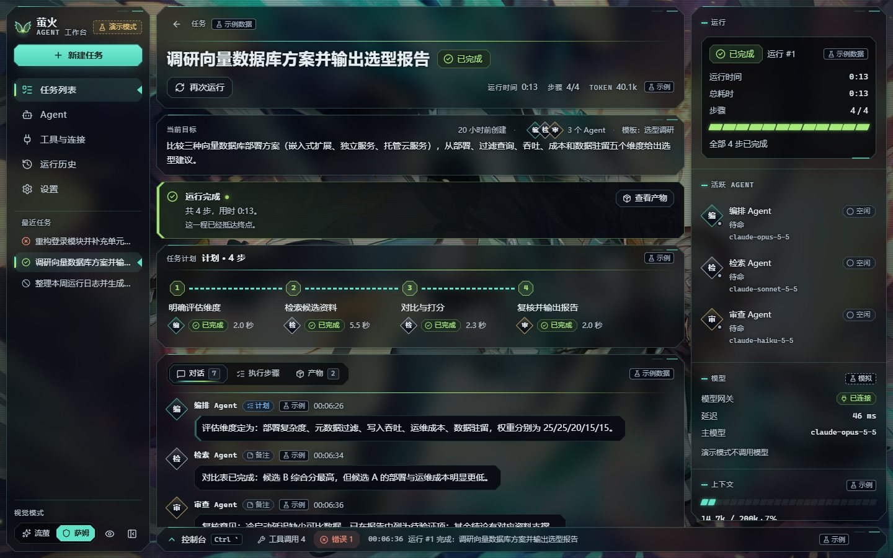

# 萤火 · Agent 工作台（Firefly Harness）

以《崩坏：星穹铁道》角色「流萤 / 萨姆」为灵感的 AI Agent Harness 桌面工作台：管理任务、编排 Agent、查看工具调用和执行进度。

> [!IMPORTANT]
> **非官方粉丝同人项目**，与米哈游 / HoYoverse 无任何关联。使用前请阅读 [免责声明与使用条款](DISCLAIMER.md)。
>
> **当前是演示模式**：没有接入任何真实 AI 模型或执行后端。界面里的 Agent 回复、工具调用、终端输出、Token 统计和连接状态全部由内置模拟器生成，并标注为「模拟」或「示例数据」。


## 下载

到 [Releases](https://github.com/xtdf0224-boop/firefly-harness/releases) 下载（Windows 10 / 11，64 位）：

| 文件 | 说明 |
| --- | --- |
| `FireflyHarness-Setup-x.y.z.exe` | 安装版：可选安装目录，创建桌面与开始菜单快捷方式 |
| `FireflyHarness-x.y.z-portable.exe` | 便携版：免安装，双击即用 |

安装包没有代码签名，Windows SmartScreen 可能提示「已保护你的电脑」，点「更多信息 → 仍要运行」即可。数据只保存在本机。

## 截图

| 工作区（流萤模式） | 萨姆模式 |
| --- | --- |
|  |  |
| **开机动画标题画面** | **赏图（Alt + W）** |
|  |  |

## 功能

- **新建任务**：写目标或选示例模板，选择参与的 Agent，创建后立即开始。
- **任务列表**：按状态筛选、搜索、排序。
- **工作区**：当前目标、任务计划、对话（可补充说明）、执行步骤（含工具调用）、产物（差异、报告，可复制 / 下载）。
- **运行控制**：开始、暂停、继续、取消、从失败处重试、从头运行；每个操作都有提示与读屏播报。
- **待确认操作**：写文件、执行命令前征求你的批准，可在工作区或右侧状态面板处理。
- **右侧状态面板**：运行状态与计时、活跃 Agent、模型网关、上下文用量、Token 消耗。
- **底部控制台**（Ctrl + `）：工具调用（输入 / 输出 / 耗时 / 错误）、终端输出、错误、事件时间线。
- **两种视觉模式**：流萤（柔和安静）与萨姆（装甲强化），切换不改变布局与功能。
- **壁纸背景与透明度设计**、**仿崩铁版本开屏的开机动画**、**减少动态效果**支持。

### 演示脚本

| 模板 | 演示内容 |
| --- | --- |
| 代码重构 | 写文件与执行命令前的确认；首次运行在「运行测试」失败（可在设置中关闭）；重试时 Agent 先修复再测 |
| 选型调研 | 网络请求 429 后自动重试；对比表与报告产物；全程无需确认 |
| 日志周报 | 低风险命令的确认；终端输出；周报产物 |
| 自定义目标 | 通用流程；回复明确标注为模拟，不假装理解了目标 |

设置 › 演示控制 里可以调整模拟速度、开关故障注入、模拟模型网关断开、重置演示数据。

## 壁纸与透明度

背景随视觉模式切换两张同人壁纸（来源见下方「第三方素材」）。设置 › 外观 › 背景壁纸：

- **壁纸可见度**（默认 80%）：夜色遮罩的轻重，100% 即原画亮度。
- **面板通透度**（默认 65%）：面板是烟色玻璃，越通透透出的壁纸越多。文字清楚靠的是每个字周围一圈淡淡的深色光晕，而不是把整块面板压暗。
- **按页面自动调节**：欢迎页让壁纸更清楚，信息密集的页面略微压暗。
- **赏图**：导航栏底部的眼睛图标或 Alt + W，界面淡出、完整看壁纸，Esc 返回。

对比度实测：对每一段文字，取字形外 2px 一圈的背景亮度与文字颜色算对比度；默认设置下两种模式约 2,500 段文字全部 ≥ 4.5:1。

## 开机动画

仿《崩坏：星穹铁道》版本开屏手工制作（流萤官方没有开屏动画）：

1. **短片**：裁自官方《流萤角色PV——「壳中萤火」》的几秒。流萤模式是「流星划过黎明的城市 → 流萤回头微笑」，萨姆模式是「装甲拼合 → 萨姆展开光翼」。1600×900、60 帧（平缓镜头运动补帧，剧烈动作保留原帧）。
2. **标题画面**：最后一帧停住并缓慢推近，萤火上飘，底部「点击进入」。
3. **进入**：点击或按任意键，一道光扫过，工作台浮上来。

设置 › 外观 里可以关闭、预览，或改成「自动进入」。

## 从源码运行

需要 Node.js 24+。

```bash
npm install
npm run dev        # 浏览器开发版：http://localhost:5317
npm run app        # 构建并以桌面窗口运行（Electron）
npm run verify     # 类型检查 + 模拟引擎状态机检查 + 生产构建检查
npm run dist:win   # 打 Windows 安装包与便携版，输出到 release/
```

技术栈：React 19 · Vite 8 · TypeScript · immer · lucide-react · 纯 CSS 设计令牌 · Electron。设计思路、组件结构与实现约定见 [docs/DESIGN.md](docs/DESIGN.md)。

### 接入真实后端

界面只通过 `src/state/backend.ts` 里的 `HarnessBackend` 接口操作运行：

```ts
interface HarnessBackend {
  readonly kind: 'mock' | 'live';
  startRun(taskId): Result<string>;
  pauseRun(runId): Result;
  resumeRun(runId): Result;
  cancelRun(runId): Result;
  retryRun(runId, mode: 'resume' | 'restart'): Result<string>;
  decideApproval(approvalId, decision: 'approve' | 'reject'): Result;
  sendMessage(taskId, text): Result;
  reconnect(connectionId): Result;
}
```

1. 实现一个 `liveBackend`，把这些调用转给你的 harness API，并把 `export const backend` 换成它。
2. 把服务端事件（计划、步骤状态、工具调用、确认请求、终端输出、用量、连接状态）写进 store，结构沿用 `src/lib/types.ts`，`source` 设为 `'live'`、`simulated` 设为 `false`，「模拟」标记会自动消失。
3. 去掉 `src/state/runner.ts` 的 `startEngine()`（模拟引擎）和 `seed.ts` 的示例历史。

## ⚠️ 免责声明

本项目为**非官方粉丝同人作品**，与 HoYoverse / 米哈游**无任何关联、背书或赞助关系**。《崩坏：星穹铁道》、「流萤」「萨姆」角色及相关美术、影像、世界观与商标等知识产权归 **HoYoverse / 米哈游** 所有。

- 本软件仅限**个人本地非商业使用**，严禁售卖、直播盈利、付费社群、捆绑销售、广告变现，或谎称为官方产品。
- 禁止将第三方素材（壁纸、开屏短片、标题画面）单独提取后再分发或用于其他项目。
- 本软件按「原样」提供，不附带任何担保；使用后果由使用者自行承担。

完整条款见 [DISCLAIMER.md](DISCLAIMER.md)（与应用内「设置 › 免责声明与使用条款」一致）。安装或使用本软件即视为同意全部条款。

**权利方联络**：如认为本项目侵犯了您的权益，请在 [Issues](https://github.com/xtdf0224-boop/firefly-harness/issues) 提交（标题注明【版权事宜】），作者会在 7 个工作日内配合处理或下架。

### 第三方素材

以下素材**不在 MIT 许可证授权范围内**，版权归各自权利人所有：

| 素材 | 位置 | 来源 |
| --- | --- | --- |
| 流萤模式壁纸「星空下飞行的流萤」 | `public/wallpapers/firefly-*` | [pixiv 作品 119791514](https://www.pixiv.net/artworks/119791514)（经 [wallhaven](https://wallhaven.cc/w/yq77og) 获取），© 原画师 |
| 萨姆模式壁纸「青焰中的流萤」 | `public/wallpapers/sam-*` | [pixiv 作品 120107524](https://www.pixiv.net/artworks/120107524)（经 [wallhaven](https://wallhaven.cc/w/vql63m) 获取），© 原画师 |
| 开机动画短片与标题画面 | `public/boot/` | 官方《流萤角色PV——「壳中萤火」》（[BV1jE421A7qK](https://www.bilibili.com/video/BV1jE421A7qK/)），© HoYoverse / 米哈游 |

## 📄 许可证

本仓库的**源代码**遵循 [MIT License](LICENSE)，Copyright (c) 2026 xtdf0224-boop。MIT 仅约束源代码，不适用于上表所列第三方素材，也不适用于角色 IP。

## 🙏 致谢

- 「流萤」「萨姆」角色与《崩坏：星穹铁道》：© HoYoverse / 米哈游
- 背景壁纸：pixiv 作品 119791514、120107524 的画师
- 开源软件：React、Vite、TypeScript、immer、lucide-react、Electron 及其社区
